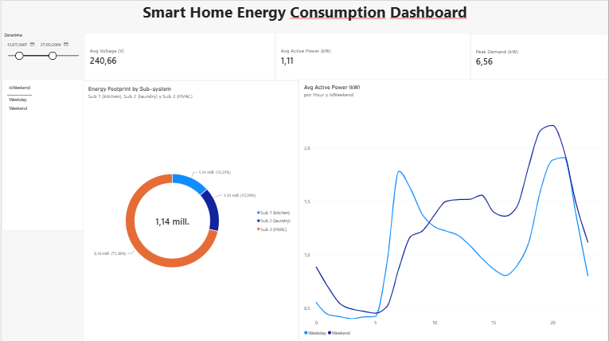

# ⚡ Smart Home Energy Consumption & Load Profile Analysis

An end-to-end time-series analytics project examining high-frequency (1-minute interval, 2M+ records) household electric power consumption data to identify peak usage patterns, seasonal demand spikes, and appliance group energy footprints.

---

## 📌 Executive Summary
* **Scale of Data:** ~2.07 million records covering residential power measurements from 2006 to 2010.
* **Core Objective:** Clean, resample, and analyze time-series electricity metrics to discover peak demand hours and understand energy distribution across household sub-systems (Kitchen, Laundry, HVAC).
* **Tech Stack:** 
  * **ETL & EDA:** Python (`Pandas`, `NumPy`, `Matplotlib`, `Seaborn`)
  * **Business Intelligence:** Power BI Desktop (`DAX`, `Power Query`)
  * **Version Control:** Git & GitHub

---

## 🏗️ Project Architecture & Data Pipeline

1. **Data Ingestion & Cleaning (`Python`):**
   * Handled missing records (`?` values) via time-based linear interpolation.
   * Converted raw date and time strings into a unified `Datetime` index.
2. **Time-Series Resampling:**
   * Aggregated high-frequency minute data into **hourly** and **daily** intervals to optimize performance and reduce storage footprint (~130 MB raw to ~2.5 MB resampled).
3. **Exploratory Data Analysis (EDA):**
   * Extracted hourly consumption profiles and evaluated weekday vs. weekend energy behaviors.
   * Computed the total energy footprint split by `Sub_metering_1` (Kitchen), `Sub_metering_2` (Laundry/Refrigeration), and `Sub_metering_3` (HVAC/Water Heater).
4. **Interactive Dashboard (`Power BI`):**
   * Formatted and imported processed datasets using US locale standards for precise decimal handling.
   * Created key DAX measures for `Avg Active Power`, `Peak Demand`, and `Avg Voltage`.
   * Built interactive visual filters for date ranges and weekday/weekend comparison.

---

## 📊 Key Insights & Analytical Findings

* **Peak Demand Window:** Electricity consumption consistently spikes in the evening hours (between 18:00 and 21:00), driven by household occupancy returning from work/school.
* **Weekday vs. Weekend Load Profile:** Weekends demonstrate a broader, more uniform energy consumption pattern starting earlier in the morning, contrasting with weekdays which show distinct morning and evening peaks.
* **Appliance Footprint Breakdown:**
  * **HVAC / Water Heating (`Sub_metering_3`):** Dominates the total measured energy footprint (~71%), making it the primary target for energy efficiency interventions.
  * **Laundry & Refrigeration (`Sub_metering_2`):** Accounts for ~15%.
  * **Kitchen (`Sub_metering_1`):** Represents ~13% of measured consumption.

---

## 🖼️ Dashboard Preview



---

## 📁 Repository Structure

```text
├── data/
│   ├── raw/                  # Contains dataset_link.txt with UCI download URL
│   └── processed/            # Resampled datasets (hourly & daily CSVs)
├── notebooks/
│   └── 01_EDA_and_Data_Cleaning.ipynb   # Python ETL and initial visualization notebook
├── dashboards/
│   └── Smart_Home_Energy_Dashboard.pbix # Interactive Power BI report file
|   └── powerbi_dashboard.png # High-resolution screenshot of the dashboard
├── .gitignore                # Ignores heavy raw text files
└── README.md                 # Project documentation
